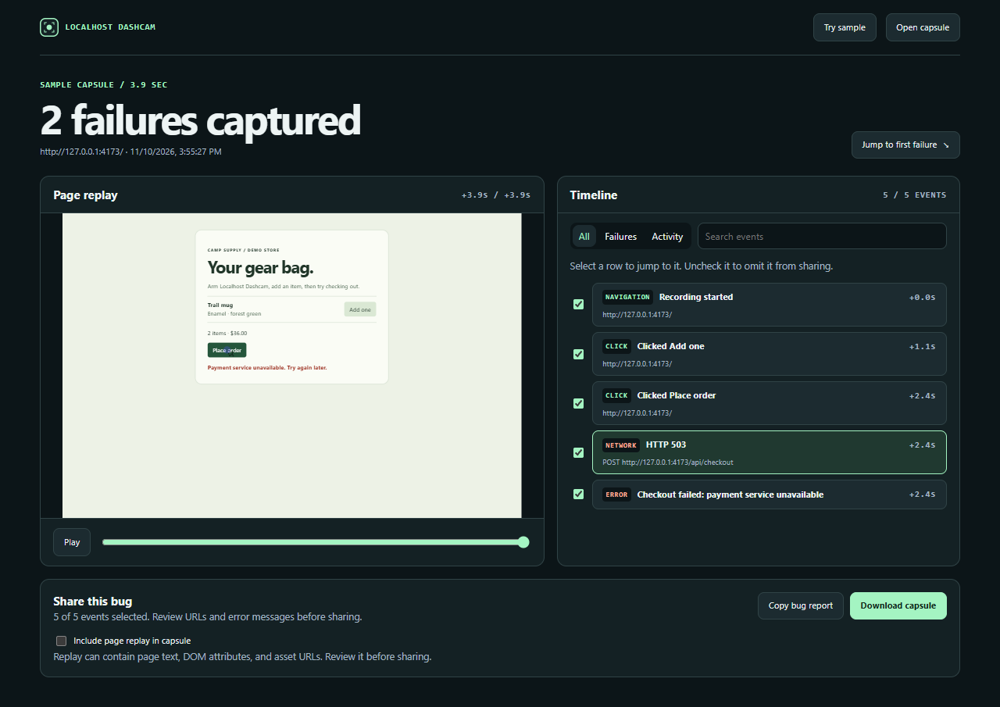

# Localhost Dashcam

**A dashcam for your dev server.** Arm a localhost tab, reproduce a bug, and save the last minute. Dashcam puts the clicks, failed requests, and console errors beside a replay you can scrub.



## Try the broken checkout

You need Node.js 18+ and Chrome or another Chromium browser that supports Manifest V3 (Chrome 120+).

```sh
npm ci
npm run build
npm run demo
```

1. In Chrome, open `chrome://extensions`, enable **Developer mode**, and choose **Load unpacked**. Select this repo's `dist` directory.
2. Open the [demo checkout](http://127.0.0.1:4173), open Dashcam, and click **Arm this tab**. The toolbar badge shows **REC**.
3. Click **Add one**, then **Place order**. The demo intentionally returns HTTP 503.
4. Click **Save last 60 seconds**. Use **Jump to first failure** to find the failed POST, then scrub the replay to see the checkout error.

To explore without a dev server, choose **Open capsule viewer → Try sample**.

Choose **Save to library** to keep a capture across browser restarts. The extension's **Capture library** lets you open, search, rename, and delete saved captures. The library stores the complete original capsule locally.

While a tab is armed, a failed request or console error also saves a capsule automatically. Open **Open latest failure** from the toolbar to recover it, even after a reload. Dashcam keeps the newest automatic capture in browser memory until Chrome closes or a newer failure replaces it.

## Share a bug

Use the failure filter or search to find the events that matter. Uncheck any event you want to leave out of both sharing formats. **Copy bug report** copies a Markdown timeline for an issue. **Download capsule** saves a JSON file another developer can open in Dashcam. Page replay is optional and starts unchecked.

To share with someone who doesn't have Dashcam, send them `dist/capsule-viewer.html` from the build along with the capsule. They can open the HTML in Chrome and drop the capsule onto it. The standalone viewer includes the sample and runs offline.

## Capture scope

- Recording starts when you arm a top-level tab on `localhost` or `127.0.0.1`. The tab stays armed for that origin until you stop it, close it, or restart Chrome. Reloads and same-origin page visits appear in the timeline. Dashcam keeps recent page history for up to three armed tabs so you can save the minute around a reload.
- Add `data-dashcam-label="Place order"` to give a click a readable timeline label.
- The page recorder holds up to 60 seconds of timeline events, capped at 400 rows. A replay may include a few seconds of lead-in for its starting DOM snapshot. Large or busy pages can get a shorter replay due to the buffer limit.
- Network events cover failed page `fetch` and XHR calls made through the instrumented functions. They include method, origin, and path. Console capture includes the first argument of `console.error`, uncaught errors, and unhandled rejections.
- Failed requests include elapsed time and HTTP status. Enable **Capture error response previews** before arming to capture a short preview of same-origin text and JSON errors. Previews are separately opt-in on export.
- Playback reconstructs the page DOM from rrweb events. Remote resources, canvas, and embedded frames can appear differently in the replay.
- Captures stay in browser memory until exported. Query strings and fragments are omitted from timeline URLs. Replay is off by default in exports and can include visible text, DOM attributes, and asset URLs. Form values are masked where rrweb supports masking. Mark sensitive DOM sections with `data-dashcam-private` and review a capsule before sharing it.

The extension uses [rrweb](https://github.com/rrweb-io/rrweb) for DOM recording and replay, and [esbuild](https://esbuild.github.io/) for bundling.

MIT
